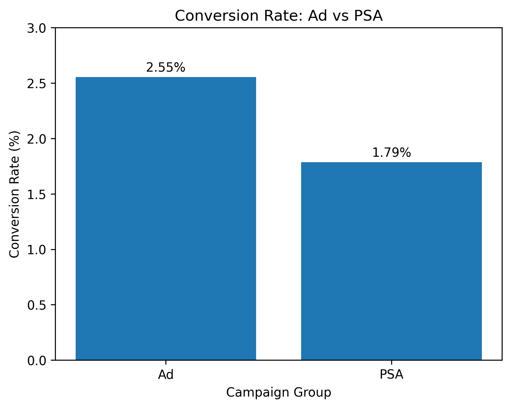

# Marketing Campaign A/B Test Analysis

[](https://colab.research.google.com/github/mehakgupta0406/marketing-ab-test-analysis/blob/main/Marketing_ab_testing.ipynb)

Analyzing whether users shown a marketing advertisement converted at a higher rate than users shown a public service announcement (PSA), using Python and SQLite.

**Status:** Core analysis, exploratory segmentation, ROI scenarios, and Streamlit dashboard implemented.

## Interactive Streamlit dashboard

The dashboard includes overall conversion rates, lift, the two-sided z-test and 95% confidence interval, day/hour/exposure comparisons, downloadable tables, and an adjustable ROI scenario calculator.

```bash
pip install -r requirements.txt
streamlit run app.py
```

Use Python 3.12 or later. Automated calculation and interface checks run on Python 3.12 in GitHub Actions. The dependency versions support the dashboard; earlier notebook outputs record the library versions used for that notebook run.

**Project results** opens immediately using aggregate counts extracted from the saved notebook outputs in `results_snapshot.json`. This is a snapshot of the real analysis, not synthetic user data. Its median exposure cutoff is 13 ads. It does not support combining user-level filters, since joint user records are not included.

**Upload CSV** accepts the original `marketing_AB.csv` and calculates fresh SQLite summaries. Filter users by most ads day, most ads hour, and Light/Heavy exposure; the median cutoff is computed from the full uploaded dataset and held fixed during filtering. Invalid columns, missing values, duplicate user IDs, invalid conversions, and out-of-range hours produce a validation message instead of silently dropping users. Empty cohorts and missing comparison groups are handled explicitly.

ROI inputs are illustrative INR assumptions, not actual financial records. For filtered cohorts, enter spend matching that cohort and campaign period. Zero spend or a zero PSA rate makes the relevant percentage undefined. Segment comparisons and interactively filtered significance results are exploratory; no adjustment is made for trying multiple cohorts.

To host on Streamlit Community Cloud, connect this repository, select `app.py` as the entrypoint, and choose a supported Python version (3.12 or later). The bundled results work without uploading the source CSV. Uploaded user data is processed in the running app; upload only data you are authorized to process on the hosting service. Hosting is a separate step; this repository does not include a deployed app URL.

Run the calculation and interface checks with `python -m unittest test_dashboard -v`.

## Business question

Does the advertising group have a higher conversion rate than the PSA comparison group, and is the difference large enough to inform a campaign decision?

The primary metric is **user conversion rate**: the number of users who converted divided by the total number of users in each group. The dataset records conversion as a Boolean; this project does not assume a specific purchase action or revenue value.

## Results

The saved notebook outputs report the following:

| Group | Users | Conversions | Conversion rate |
| --- | ---: | ---: | ---: |
| Marketing ad (`ad`) | 564,577 | 14,423 | 2.55% |
| Public service announcement (`psa`) | 23,524 | 420 | 1.79% |
| **Total** | **588,101** | **14,843** | |

- **Absolute difference:** +0.77 percentage points for the ad group.
- **Relative lift:** +43.09% compared with the PSA group.

Lift is calculated from the unrounded rates:

```text
Absolute difference = ad conversion rate − PSA conversion rate
Relative lift (%)   = (ad conversion rate / PSA conversion rate − 1) × 100
```

The ad group had a higher conversion rate than the PSA group.
A two-sided two-proportion z-test found a statistically significant
difference (z = 7.370, p < 0.001).

The estimated difference was 0.769 percentage points, with a
95% confidence interval of 0.587 to 0.936 percentage points.

Causal interpretation depends on valid experiment design.
Campaign costs and conversion values are needed to assess profitability.

### Conversion-rate chart




## Dataset

**Source:** [Marketing A/B Testing by Favio Vázquez on Kaggle](https://www.kaggle.com/datasets/faviovaz/marketing-ab-testing)  
**Input file:** `marketing_AB.csv`  
**Size shown in the notebook:** 588,101 rows, with six analytical fields after removing the exported index column.

| Original column | Description |
| --- | --- |
| `user id` | User identifier |
| `test group` | Group label: `ad` or `psa` |
| `converted` | Whether the user converted |
| `total ads` | Recorded number of ads shown to the user |
| `most ads day` | Day on which the user saw the most ads |
| `most ads hour` | Hour at which the user saw the most ads |

The source CSV is not included in this repository. Download it from Kaggle to reproduce the analysis.

## Work completed

1. Loaded the CSV and inspected its dimensions, data types, and non-null counts.
2. Removed the exported index column, `Unnamed: 0`.
3. Checked duplicate rows, duplicate user IDs, and group labels.
4. Loaded the data into an in-memory SQLite database.
5. Used SQL to aggregate users, conversions, and conversion rates by group.
6. Calculated absolute and relative conversion lift in Python.
7. Compared conversion rates using a two-sided two-proportion z-test.
8. Calculated a 95% confidence interval for the conversion-rate difference.
9. Visualized conversion rates and group sizes.
10. Documented the business conclusion and analysis limitations.
11. Verified that the notebook runs from beginning to end.
12. Recorded library versions in requirements.txt.
13. Compared conversion rates and lift by day, hour, and Light/Heavy ad exposure.
14. Modeled ROI and break-even campaign spend under illustrative financial assumptions.

**Tools used:** Python, pandas, SQLite through Python's `sqlite3` module, and Google Colab.

## Run the current analysis

1. Open the notebook using the **Open in Colab** button above.
2. Save a copy to your Google Drive if you want to edit it.
3. Download and extract the dataset from Kaggle. Sign in if prompted.
4. Upload `marketing_AB.csv` to the Colab runtime using the Files panel.
5. Confirm that the file is in the runtime's working directory, matching:
   ```python
   df = pd.read_csv("marketing_AB.csv")
   ```
6. Start a fresh runtime and run the notebook cells in order.

The notebook imports `pandas` and `sqlite3`; SQLite support is included with Python. The database exists only in memory. Colab runtime files must be uploaded again when the runtime is reset.

### Dependencies

The current app dependencies are recorded in `requirements.txt`.
The notebook's saved version-report cell records the versions used for its run.

To install them locally, run:

```bash
pip install -r requirements.txt
```

## Interpretation and limitations

- The groups have substantially different sample sizes. Unequal allocation alone does not establish a problem; the intended allocation is needed to assess a sample-ratio mismatch.
- Causal conclusions depend on valid random assignment and independent observations. These assumptions need to be assessed using the available experiment documentation.
- Ad exposure, day, and hour describe observed activity. Associations with conversion should not be treated as causal targeting recommendations.
- Actual campaign costs and conversion values are unavailable. The ROI scenario analysis uses illustrative assumptions and does not establish actual profitability.
- Statistical significance, practical value, and generalizability must be considered separately when writing the final recommendation.
  
## Skills demonstrated

- Python and pandas for data inspection and validation.
- SQLite for aggregation and conversion-rate calculations.
- Hypothesis testing and confidence intervals.
- Matplotlib for visualizing results.
- Business interpretation and communication of limitations.


## Segment analysis

Exploratory analysis compares Ad and PSA conversion rates by `most ads day`, `most ads hour`, and `total ads`. These findings summarize the updated Colab outputs for all 588,101 users.

### Conversion by most ads day

- Monday had the highest observed Ad conversion rate: **3.32%**, compared with **2.26%** for PSA.
- Tuesday showed the largest observed Ad–PSA difference: **1.60 percentage points**, with **110.69% relative lift**.
- Thursday showed the smallest difference: **0.14 percentage points**, with **6.95% relative lift**.
- Ad conversion rates exceeded PSA rates across all seven days.

### Conversion by most ads hour

- **16:00 (4 PM)** had the highest observed Ad conversion rate: **3.09%**, compared with **2.81%** for PSA.
- **20:00 (8 PM)** had an Ad conversion rate of **3.03%**, compared with **1.76%** for PSA, with a difference of **1.26 percentage points**.
- The largest defined relative lift occurred at **07:00 (7 AM): 119.02%**.
- Ad conversion rates exceeded PSA rates at all hours except **03:00**, when rates were **1.04%** and **1.12%**, respectively.
- Relative lift was undefined (`NaN`) at hours 0, 1, 2, 4, 5, and 6 because the PSA conversion rate was zero.

### Conversion by ad exposure

The median `total ads` value was **13**. The same cutoff was applied to both test groups: **Light exposure = 13 ads or fewer**, and **Heavy exposure = more than 13 ads**. Users tied at the median belong to Light exposure, so segment sizes need not be equal.

| Exposure | Ad conversion rate | PSA conversion rate | Difference (percentage points) | Relative lift |
| --- | ---: | ---: | ---: | ---: |
| Light (≤ 13 ads) | 0.38% | 0.40% | −0.03 | −7.07% |
| Heavy (> 13 ads) | 4.81% | 3.38% | +1.43 | +42.25% |

Relative lift (%) = ((Ad conversion rate − PSA conversion rate) / PSA conversion rate) × 100. Differences and lift were calculated from unrounded rates, so subtracting displayed rates may give slightly different results.

These comparisons are exploratory; statistical significance was not tested within segments. Day and hour describe when users saw the most ads, not when they converted. Exposure is observed activity rather than a randomized treatment, so higher conversion among heavily exposed users does not establish that showing more ads causes more conversions. Check segment user and conversion counts before drawing conclusions, especially for hours with low or zero PSA conversions.


## ROI scenario analysis

The source dataset contains no campaign spend, revenue, or contribution values. All financial inputs below are **illustrative assumptions in INR**, not actual financial results or researched industry benchmarks. They are kept separate from the original user data.

**Contribution per conversion** means revenue minus variable product/service costs, before campaign spend and fixed business expenses.

### Method

Using the unrounded overall conversion rates, the estimated additional conversions among the 564,577 Ad users were **4,342.98**. This compares observed Ad conversions with the conversions expected if the same users converted at the PSA rate. Interpreting this difference as a campaign effect depends on valid random assignment and experiment design.

```text
Additional conversions = (Ad rate − PSA rate) × Ad users
Incremental contribution = Additional conversions × Assumed contribution per conversion
Net contribution = Incremental contribution − Assumed campaign cost
Estimated ROI (%) = (Net contribution / Assumed campaign cost) × 100
Break-even campaign spend = Incremental contribution
```

Rates in the additional-conversions formula are proportions, not percentages. Calculations retain unrounded values; displayed results are rounded.

### Assumptions and results

| Scenario | Assumed campaign cost (INR) | Assumed contribution per conversion (INR) | Estimated net contribution (INR) | Estimated ROI | Break-even campaign spend (INR) |
| --- | ---: | ---: | ---: | ---: | ---: |
| Conservative | 600,000 | 100 | −165,701.79 | −27.6% | 434,298.21 |
| Moderate | 400,000 | 150 | 251,447.32 | 62.9% | 651,447.32 |
| Optimistic | 200,000 | 200 | 668,596.43 | 334.3% | 868,596.43 |

The conservative scenario does not cover assumed campaign spend. The moderate and optimistic scenarios produce positive modeled net contribution after variable costs and campaign spend. Break-even spend is the maximum campaign spend covered by the estimated incremental contribution, before fixed business expenses.

Both spend and contribution per conversion vary across scenarios, so the results reflect their combined influence. These are point-estimate scenarios, not forecasts or confidence bounds; they do not incorporate sampling uncertainty in the conversion-rate difference. Actual ROI requires matching financial data and a valid estimate of incremental campaign impact.
